# 分析工具与方法 · 关系网

> 100 个方法里，真正独立的不多。这份文件把「重叠、上下游、近似重复」三类关系画出来，
> 每个板块标注侧重点，避免把同一件事用两套工具做两遍。

## 关系类型说明

| 类型 | 含义 | 处理建议 |
| --- | --- | --- |
| 上下游 | 前者产出是后者输入 | 按顺序用，别跳过前者 |
| 同族 | 解决同一类问题、视角不同 | 按场景选一个，不要同时上 |
| 近似重复 | 结构高度雷同，换名字 | 只留一个，另一个记作别名 |

## 关系统计

| 关系 | 条数 |
| --- | --- |
| 上下游 | 27 |
| 同族 | 20 |
| 近似重复 | 5 |

共 52 条关系边，涉及 72 个方法（占 100 个的 72%）。

## 一、必须合并的近似重复（先看这一节）

| 保留 | 别名/合并对象 | 差别 |
| --- | --- | --- |
| **S1-04** GE矩阵 | 定向政策矩阵 | 定向政策矩阵与 GE 矩阵结构几乎一致，差别只在强调政策取向 |
| **S3-01** 平衡计分卡 | 绩效棱柱模型 | 绩效棱柱是对 BSC 的利益相关者扩展版 |
| **S4-03** 定置管理 | 5S现场管理法 | 定置管理实质是 5S 中「整顿」的展开，单独用会与 5S 冲突 |
| **S6-02** ECR系统 | 快速反应策略 | ECR 与快速反应都靠数据共享缩短补货周期，前者偏快消、后者偏服装 |
| **S7-08** 综摄法 | 戈登法 | 戈登法是综摄法的变体，只差「是否向参与者公布真实问题」 |

## 二、关键链路（按顺序用，别跳步）

### 链路 1：战略规划全链路

**S1-02** PEST分析 → **S1-09** 波特五力分析 → **S1-01** SWOT分析 → **S1-16** SPACE矩阵 → **S1-17** QSPM矩阵

> 先看宏观与行业（PEST→五力），再盘自身（SWOT），再用 SPACE 定姿态、QSPM 定方案。跳步的典型后果：没有行业判断就套 SWOT，结论全是形容词。

### 链路 2：业务组合配置链路

**S1-03** BCG矩阵 → **S1-04** GE矩阵 → **S1-08** 麦肯锡三层面分析

> BCG 粗分 → GE 多因素细化 → 三层面决定资源在三类业务间的分配。三者回答同一件事，别在一份报告里同时出现三张矩阵。

### 链路 3：营销从定位到落地

**S2-01** STP分析 → **S2-02** 4Ps营销组合 → **S2-03** 产品生命周期模型 → **S2-04** 安索夫矩阵

> STP 定人群与定位 → 4P 做组合 → 生命周期决定打法 → 安索夫决定增长路径。常见错误：直接跳到 4P，跳过 STP，做出四份互不相关的动作清单。

### 链路 4：服务质量诊断链路

**S2-05** 服务质量差距模型 → **S2-08** 服务金三角 → **S2-13** 满意镜 → **S2-12** 服务利润链

> 差距模型定位缺口 → 金三角查组织对齐 → 利润链看传导 → 满意镜做双向验证。四者都是服务管理族，做一套即可，重复做只是换张图。

### 链路 5：绩效体系搭建链路

**S3-01** 平衡计分卡 → **S3-03** KPI → **S3-02** 360度绩效考核 → **S3-09** 绩效棱柱模型

> BSC 定四维指标 → KPI 逐层承接 → 360 度补行为反馈 → 棱柱做利益相关者扩展。常见翻车：BSC 与 KPI 两套指标并行，基层被考两遍。

### 链路 6：岗位到薪酬链路

**S3-05** 职位分析问卷法 → **S3-06** 关键事件技术 → **S3-15** 海氏工作评价系统 → **S3-11** 宽带薪酬设计

> PAQ/关键事件描述岗位 → 海氏给岗位分值 → 宽带薪酬承接带宽。跳过岗位评估直接定薪，是内部不公平的主要来源。

### 链路 7：质量改善闭环

**S4-04** 5S现场管理法 → **S4-01** TPM全员生产维护 → **S4-17** 丰田生产方式 → **S4-05** 六西格玛 → **S4-19** 为什么—为什么分析法 → **S4-20** 8D工作法

> 5S 打现场底子 → TPM 管设备 → TPS 定体系 → 六西格玛做数据改善 → 5Why 找根因 → 8D 闭环。断开其中一环，改善就会回退。

### 链路 8：财务体检到投资决策

**S5-04** 比率分析法 → **S5-03** 杜邦分析法 → **S5-01** 阿特曼Z-score模型 → **S5-08** 净现值法NPV → **S5-10** 本量利分析

> 比率分析出原始数据 → 杜邦看 ROE 结构 → Z-score 出预警 → 本量利算保本 → NPV 判项目。先算能不能活，再算该不该投。

### 链路 9：供应链从模型到执行

**S6-01** SCOR模型 → **S6-02** ECR系统 → **S6-03** 快速反应策略 → **S6-09** VMI供应商管理库存

> SCOR 建模对标 → ECR/QR 定补货策略 → VMI 落地库存协同。只做 SCOR 不着地，是最常见的形式主义。

### 链路 10：项目从拆解到控期

**S6-10** 工作分解结构WBS → **S6-05** 责任矩阵RACI → **S6-06** 关键路径法CPM → **S6-08** PERT网络分析法 → **S4-09** 甘特图

> WBS 拆工作包 → RACI 定责任 → CPM 找关键路径 → PERT 算工期概率 → 甘特图做可视化管理。跳过 WBS 直接排甘特，等于排了一份假进度。

### 链路 11：集体决策与创意

**S7-04** 头脑风暴法 → **S7-10** 奥斯本检核表法 → **S7-08** 综摄法 → **S7-03** KT决策法 → **S7-07** 决策树分析法 → **S7-01** 德尔菲法

> 头脑风暴/检核表/综摄法发散 → KT 做结构化取舍 → 决策树算期望 → 德尔菲收敛专家分歧。发散与收敛必须分开做，混在一起效率最低。

## 三、各板块的侧重点（横向对比）

| 板块 | 核心问题 | 输出物 | 常见误用 |
| --- | --- | --- | --- |
| 战略与组织 | 往哪走、靠什么赢 | 业务组合与资源配置 | 矩阵画三张，结论互斥 |
| 营销与服务 | 卖给谁、凭什么买 | 定位主张与营销组合 | 跳过 STP 直接做 4P |
| 人力资源 | 用谁、怎么衡量与激励 | 岗位、指标、薪酬体系 | BSC 与 KPI 两套并行 |
| 质量与生产 | 怎么稳定做对、怎么更快 | 标准作业与改善闭环 | 只学工具不学管理逻辑 |
| 财务与经营 | 能不能活、该不该投 | 预警、结构与投资判断 | 用模型精度掩盖预测误差 |
| 项目与物流 | 怎么按时按成本交付 | 拆解、责任、关键路径 | 跳过 WBS 直接排甘特 |
| 决策思维 | 怎么想清楚、怎么收敛 | 选项排序与创意池 | 发散与收敛混在一起 |

## 四、关系图（Mermaid，Obsidian 与 Typora 可直接渲染）

```mermaid
graph LR
  subgraph S1[战略与组织]
    S1_01(["SWOT分析"])
    S1_02(["PEST分析"])
    S1_03(["BCG矩阵"])
    S1_04(["GE矩阵"])
    S1_05(["定向政策矩阵"])
    S1_06(["IE矩阵"])
    S1_07(["竞争态势矩阵"])
    S1_08(["麦肯锡三层面分析"])
    S1_09(["波特五力分析"])
    S1_10(["战略集团分析法"])
    S1_11(["战略钟模型"])
    S1_12(["核心竞争力分析"])
    S1_13(["波特价值链分析"])
    S1_14(["利益相关者分析"])
    S1_15(["PIMS分析法"])
    S1_16(["SPACE矩阵"])
    S1_17(["QSPM矩阵"])
    S1_18(["三四规则矩阵"])
    S1_19(["7S模型"])
    S1_20(["3C战略三角模型"])
  end
  subgraph S2[营销与服务]
    S2_01(["STP分析"])
    S2_02(["4Ps营销组合"])
    S2_03(["产品生命周期模型"])
    S2_04(["安索夫矩阵"])
    S2_05(["服务质量差距模型"])
    S2_06(["推销方格理论"])
    S2_07(["哈夫模型"])
    S2_08(["服务金三角"])
    S2_09(["CS战略"])
    S2_10(["SPIN销售法"])
    S2_11(["营销战略新三角模型"])
    S2_12(["服务利润链"])
    S2_13(["满意镜"])
    S2_14(["顾客金字塔模型"])
    S2_15(["植田T理论"])
  end
  subgraph S3[人力资源]
    S3_01(["平衡计分卡"])
    S3_02(["360度绩效考核"])
    S3_03(["KPI"])
    S3_04(["3P模型"])
    S3_05(["职位分析问卷法"])
    S3_06(["关键事件技术"])
    S3_07(["贝尔宾团队角色理论"])
    S3_08(["盖洛普Q12测评法"])
    S3_09(["绩效棱柱模型"])
    S3_10(["Lifo管理系统"])
    S3_11(["宽带薪酬设计"])
    S3_12(["霍兰德职业兴趣理论"])
    S3_13(["胜任素质模型"])
    S3_14(["职业锚"])
    S3_15(["海氏工作评价系统"])
  end
  subgraph S4[质量与生产]
    S4_01(["TPM全员生产维护"])
    S4_02(["TQM全面质量管理"])
    S4_03(["定置管理"])
    S4_04(["5S现场管理法"])
    S4_05(["六西格玛"])
    S4_06(["JIT生产方式"])
    S4_07(["QFD质量功能展开"])
    S4_08(["田口方法"])
    S4_09(["甘特图"])
    S4_10(["OPT最优生产技术"])
    S4_11(["PDCA循环"])
    S4_12(["AUDIT法"])
    S4_13(["大规模定制"])
    S4_14(["朱兰三步曲"])
    S4_15(["零缺陷管理法"])
    S4_16(["QC七大手法"])
    S4_17(["丰田生产方式"])
    S4_18(["品管圈"])
    S4_19(["为什么—为什么分析法"])
    S4_20(["8D工作法"])
  end
  subgraph S5[财务与经营]
    S5_01(["阿特曼Z-score模型"])
    S5_02(["ABC成本法"])
    S5_03(["杜邦分析法"])
    S5_04(["比率分析法"])
    S5_05(["经济附加值EVA"])
    S5_06(["财务分析雷达图"])
    S5_07(["零基预算法"])
    S5_08(["净现值法NPV"])
    S5_09(["沃尔评分法"])
    S5_10(["本量利分析"])
  end
  subgraph S6[项目与物流]
    S6_01(["SCOR模型"])
    S6_02(["ECR系统"])
    S6_03(["快速反应策略"])
    S6_04(["绿色供应链管理"])
    S6_05(["责任矩阵RACI"])
    S6_06(["关键路径法CPM"])
    S6_07(["逻辑框架法"])
    S6_08(["PERT网络分析法"])
    S6_09(["VMI供应商管理库存"])
    S6_10(["工作分解结构WBS"])
  end
  subgraph S7[决策思维]
    S7_01(["德尔菲法"])
    S7_02(["六顶思考帽"])
    S7_03(["KT决策法"])
    S7_04(["头脑风暴法"])
    S7_05(["垃圾桶模型"])
    S7_06(["5W2H分析法"])
    S7_07(["决策树分析法"])
    S7_08(["综摄法"])
    S7_09(["戈登法"])
    S7_10(["奥斯本检核表法"])
  end
  S1_03 --- S1_04
  S1_04 -. 重复 .-> S1_05
  S1_04 --- S1_06
  S1_09 --> S1_10
  S1_01 --> S1_16
  S1_16 --> S1_17
  S1_01 --> S1_17
  S1_12 --> S1_13
  S1_19 --> S1_13
  S2_03 --> S2_02
  S2_01 --> S2_02
  S2_04 --- S2_02
  S2_05 --- S2_13
  S2_08 --- S2_13
  S2_09 --> S2_14
  S2_10 --- S2_06
  S3_01 --> S3_03
  S3_01 -. 重复 .-> S3_09
  S3_02 --- S3_01
  S3_05 --> S3_15
  S3_06 --> S3_13
  S3_11 --> S3_15
  S4_02 --- S4_13
  S4_05 --> S4_11
  S4_06 --> S4_10
  S4_17 --> S4_06
  S4_19 --> S4_20
  S4_16 --> S4_19
  S4_03 -. 重复 .-> S4_04
  S4_01 --- S4_04
  S5_01 --> S5_04
  S5_03 --> S5_04
  S5_05 --- S5_03
  S5_08 --> S5_10
  S5_07 --> S5_10
  S6_01 --- S6_02
  S6_02 -. 重复 .-> S6_03
  S6_09 --- S6_03
  S6_05 --> S6_10
  S6_06 --- S6_08
  S6_06 --> S6_10
  S7_08 -. 重复 .-> S7_09
  S7_04 --- S7_10
  S7_03 --> S7_07
  S7_01 --- S7_05
  S1_20 --- S2_01
  S4_09 --> S6_10
  S4_09 --- S6_06
  S4_19 --- S7_06
  S5_04 --> S3_01
  S2_13 --- S3_08
  S4_11 --- S6_09
```

实线箭头＝上下游；点线＝近似重复；无箭头实线＝同族。

## 五、关系明细（逐条）

### 上下游（27 条）

| 从 | 到 | 说明 |
| --- | --- | --- |
| S1-09 波特五力分析 | S1-10 战略集团分析法 | 先用五力判断行业吸引力，再用战略集团看内部格局 |
| S1-01 SWOT分析 | S1-16 SPACE矩阵 | SWOT 出定性结论，SPACE/QSPM 把结论变成可比较的分数 |
| S1-16 SPACE矩阵 | S1-17 QSPM矩阵 | SPACE 定姿态，QSPM 在多方案间做最终打分选择 |
| S1-01 SWOT分析 | S1-17 QSPM矩阵 | QSPM 的输入通常就是 SWOT 的关键因素与权重 |
| S1-12 核心竞争力分析 | S1-13 波特价值链分析 | 先用价值链拆环节，再判断哪个环节构成核心竞争力 |
| S1-19 7S模型 | S1-13 波特价值链分析 | 7S 检查组织能否支撑价值链上的战略选择 |
| S2-03 产品生命周期模型 | S2-02 4Ps营销组合 | 生命周期阶段决定 4P 各要素的组合方式 |
| S2-01 STP分析 | S2-02 4Ps营销组合 | STP 定住谁和定位，4P 才是落地动作 |
| S2-09 CS战略 | S2-14 顾客金字塔模型 | CS 战略管满意度，顾客金字塔管按利润分级投入 |
| S3-01 平衡计分卡 | S3-03 KPI | BSC 定战略指标，KPI 做逐层承接 |
| S3-05 职位分析问卷法 | S3-15 海氏工作评价系统 | PAQ 描述岗位内容，海氏评估给出岗位分值 |
| S3-06 关键事件技术 | S3-13 胜任素质模型 | 关键事件访谈是胜任素质建模的标准数据来源 |
| S3-11 宽带薪酬设计 | S3-15 海氏工作评价系统 | 海氏定级后，宽带薪酬提供带宽承接 |
| S4-05 六西格玛 | S4-11 PDCA循环 | 六西格玛的 DMAIC 与 PDCA 同构，只是更强调统计 |
| S4-06 JIT生产方式 | S4-10 OPT最优生产技术 | JIT 追求准时化，OPT 提醒约束在瓶颈，二者需联合使用 |
| S4-17 丰田生产方式 | S4-06 JIT生产方式 | 丰田生产方式是 JIT 与自働化的母体 |
| S4-19 为什么—为什么分析法 | S4-20 8D工作法 | 5Why 找根因，8D 把根因放进闭环流程 |
| S4-16 QC七大手法 | S4-19 为什么—为什么分析法 | QC 七大手法出数据与图形，5Why 做纵向追问 |
| S5-01 阿特曼Z-score模型 | S5-04 比率分析法 | 比率分析出原始指标，Z-score 把指标加权成预警分 |
| S5-03 杜邦分析法 | S5-04 比率分析法 | 杜邦把 ROE 拆开，比率分析提供拆解所需的原始比率 |
| S5-08 净现值法NPV | S5-10 本量利分析 | 本量利算保本销量，NPV 判断项目是否值得投 |
| S5-07 零基预算法 | S5-10 本量利分析 | 零基预算管费用，本量利管盈亏平衡 |
| S6-05 责任矩阵RACI | S6-10 工作分解结构WBS | WBS 拆出工作包，RACI 给每个包分配责任 |
| S6-06 关键路径法CPM | S6-10 工作分解结构WBS | WBS 是 CPM 网络图的前置 |
| S7-03 KT决策法 | S7-07 决策树分析法 | KT 的决策分析给出条件与权重，决策树给出概率与期望值 |
| S4-09 甘特图 | S6-10 工作分解结构WBS | WBS 拆出工作包，甘特图才有东西可排；跳过 WBS 直接画甘特是假进度 |
| S5-04 比率分析法 | S3-01 平衡计分卡 | 比率分析产出的财务指标，是平衡计分卡「财务维度」的直接输入 |

### 同族（20 条）

| 从 | 到 | 说明 |
| --- | --- | --- |
| S1-03 BCG矩阵 | S1-04 GE矩阵 | BCG 用两维粗分，GE 换成多因素九宫格，是同一问题的升级版 |
| S1-04 GE矩阵 | S1-06 IE矩阵 | IE 矩阵是 GE 九宫格的评分流程化版本 |
| S2-04 安索夫矩阵 | S2-02 4Ps营销组合 | 安索夫管增长路径，4P 管路径上的营销执行 |
| S2-05 服务质量差距模型 | S2-13 满意镜 | 服务质量差距定位缺口，服务利润链解释缺口如何传导到利润 |
| S2-08 服务金三角 | S2-13 满意镜 | 服务金三角与满意镜同属服务管理族，前者看结构，后者看双向满意 |
| S2-10 SPIN销售法 | S2-06 推销方格理论 | SPIN 是提问式销售法，推销方格是销售风格诊断，常配套使用 |
| S3-02 360度绩效考核 | S3-01 平衡计分卡 | 360 度提供行为反馈，BSC 提供结果指标，二者互补 |
| S4-02 TQM全面质量管理 | S4-13 大规模定制 | TQM 是体系，六西格玛与朱兰三步曲是其下的改善方法论 |
| S4-01 TPM全员生产维护 | S4-04 5S现场管理法 | TPM 的自主保全以 5S 为现场基础 |
| S5-05 经济附加值EVA | S5-03 杜邦分析法 | EVA 与杜邦都在回答「资本是否被有效使用」，前者扣资本成本 |
| S6-01 SCOR模型 | S6-02 ECR系统 | SCOR 是参考模型，ECR/QR 是其下的行业落地策略 |
| S6-09 VMI供应商管理库存 | S6-03 快速反应策略 | VMI 是补货协同的具体机制，可视为快速反应的库存实现 |
| S6-06 关键路径法CPM | S6-08 PERT网络分析法 | CPM 与 PERT 同为网络计划技术，前者工期确定、后者工期不确定 |
| S7-04 头脑风暴法 | S7-10 奥斯本检核表法 | 头脑风暴与奥斯本检核表都是创意发散工具，前者靠人、后者靠清单 |
| S7-01 德尔菲法 | S7-05 垃圾桶模型 | 德尔菲追求收敛，垃圾桶模型承认组织决策的偶然性，是两种相反的决策观 |
| S1-20 3C战略三角模型 | S2-01 STP分析 | 3C 挂在战略篇但本质是营销定位框架，与 STP 解同一道题：先认清三方再定位置 |
| S4-09 甘特图 | S6-06 关键路径法CPM | 甘特图与关键路径法同为进度工具，前者看时间轴、后者找最长路径 |
| S4-19 为什么—为什么分析法 | S7-06 5W2H分析法 | 5Why 纵向追问因果，5W2H 横向问全要素，实际排查时常配对使用 |
| S2-13 满意镜 | S3-08 盖洛普Q12测评法 | 服务利润链与盖洛普 Q12 讲的是同一条链：员工满意→顾客满意→利润 |
| S4-11 PDCA循环 | S6-09 VMI供应商管理库存 | PDCA 的持续改善循环，是 VMI 补货策略每周复盘时用的节奏框架 |

### 近似重复（5 条）

| 从 | 到 | 说明 |
| --- | --- | --- |
| S1-04 GE矩阵 | S1-05 定向政策矩阵 | 定向政策矩阵与 GE 矩阵结构几乎一致，差别只在强调政策取向 |
| S3-01 平衡计分卡 | S3-09 绩效棱柱模型 | 绩效棱柱是对 BSC 的利益相关者扩展版 |
| S4-03 定置管理 | S4-04 5S现场管理法 | 定置管理实质是 5S 中「整顿」的展开，单独用会与 5S 冲突 |
| S6-02 ECR系统 | S6-03 快速反应策略 | ECR 与快速反应都靠数据共享缩短补货周期，前者偏快消、后者偏服装 |
| S7-08 综摄法 | S7-09 戈登法 | 戈登法是综摄法的变体，只差「是否向参与者公布真实问题」 |
